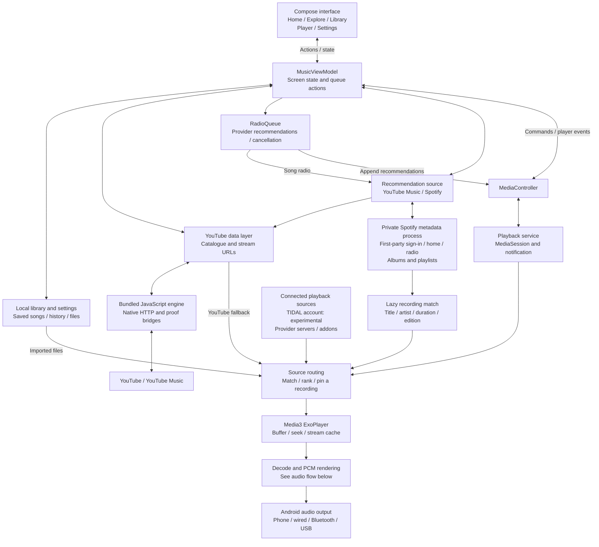
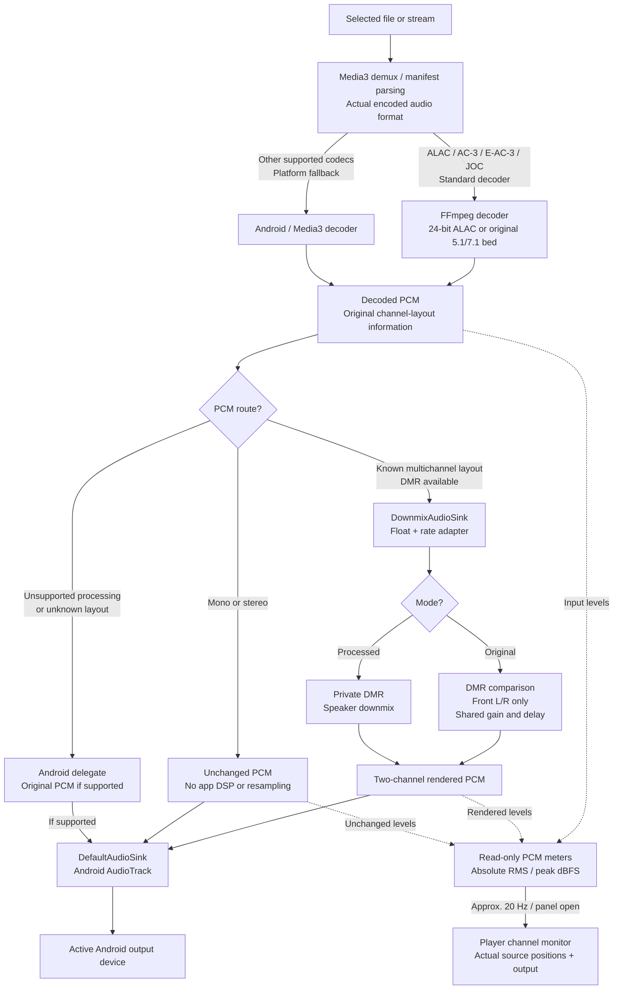
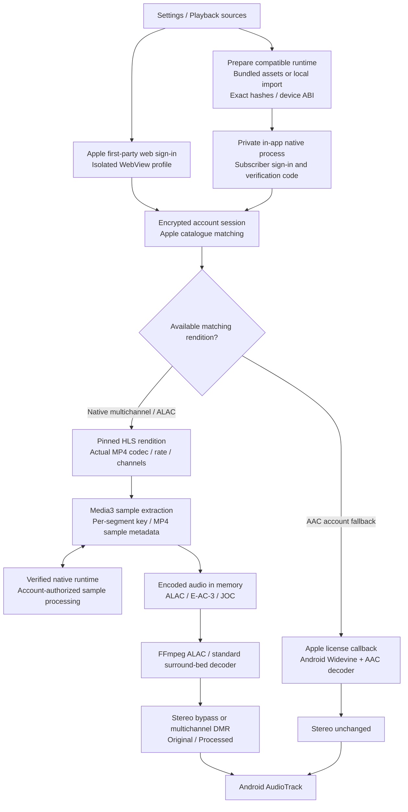
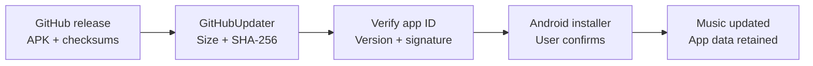

# Music for Android

Temporary name: **Music**. Native Android player from RTensorLabs with the approved
Margin visual direction: warm paper, DM Sans, original provider artwork and raspberry controls.

## Architecture

Music has three main paths: **discover a recording**, **choose its audio source**,
and **decode/render it inside the Android app**. The diagrams describe the current
implementation; experimental adapters and unfinished integrations are labelled.

### App and playback control



The user chooses **YouTube Music or Spotify** under Settings → Playback →
Recommendation source. Spotify connects through its own first-party sign-in page
in an isolated metadata process. It is experimental and needs account/device
validation; no Spotify audio or second audio player is used.

The ViewModel uses local listening history only to choose seeds for Mixed for you.
YouTube candidates retain the existing on-device ranking; Spotify pools retain
provider order. Up next comes from the selected provider through `RadioQueue`, preserving provider order
and excluding already-queued songs. Individual selections seed radio; explicit
albums/playlists and Play all keep their lists. History is not an autoplay pool.
The catalogue item keeps its YouTube or Spotify discovery identity, artwork
and history when another source supplies the audio. Matching checks title, artist, duration and edition.
Available candidates rank **JOC first → discrete lossless multichannel → lossless
stereo by sample rate/bit depth**, with local files competing against connected
sources. An explicitly imported local track plays its own file directly.

Source selection happens before the physical MediaSource is created. Seeks retain
that source and encoding. A failed or contradictory provider format triggers a
bounded fallback through a new source at the current position. Rendition rejection
is independent of rotating URLs; byte-cache reuse across changing paths requires
an explicit immutable-file identity. Adaptive streams keep their representation
pinned and bypass the progressive-file cache.

The hidden WebViews run the bundled YouTube client and proof code; **ExoPlayer
plays the audio**. Provider requests and source selection run off the UI/audio
threads. Software decoding uses a worker; PCM rendering runs in Media3's audio
path. Player events and `AudioPipeline` reports update the UI, while a separate
position StateFlow updates the timelines without rebuilding the whole screen.
The expandable channel monitor has its own level StateFlow; metering is disabled
when collapsed, paused or outside the foreground.

### Audio signal flow



The adapter converts known multichannel **44.1/88.2/176.4 kHz → 48/96/192 kHz**
for the core. Stereo bypasses that conversion. Music uses unity preamp for the surround path, retaining the original core's peak
limiter instead of the previous fixed −14 dB cut. Stereo bytes remain unchanged.
Original and Processed share the
stream lifecycle and switch with a fade, without loading another recording.
The private adapter explicitly disables synthetic upmixing. The standard decoder
feeds its original 5.1/7.1 bed to DMR; no invented side, rear or height speakers,
HRIR convolution or app binaural stage is added.

The private DMR is bundled into integrated APKs through JNI; there is no separate
DSP app to install. Its implementation and coefficients stay outside this public
repository. **Multichannel here describes the decoded input:** processed output is two-channel PCM. Physical output routing remains Android's
responsibility. Android's mixer/hardware may convert
audio, so stereo bypass does not establish system-wide bit-perfect output.

Unsupported layouts use the Android delegate only when it accepts the format.
Other failures are classified by decoder, layout, DSP or output stage and reported
back to the player.

Music uses FFmpeg's standard E-AC-3/JOC surround-bed decode. The experimental
scene decoder is not registered or packaged, and its setting is removed.
[PCM/DSP integration](dsp/README.md) and [provider status](PROVIDER_PLAYBACK_STATUS.md)
describe the current route. Decoder research remains in its standalone module.

[Spotify integration research](SPOTIFY_INTEGRATION_RESEARCH.md) compares direct
free-account playback approaches and documents the separate web-engine boundary.
Spotify **recommendations** are integrated experimentally; direct Spotify audio
playback is not. See [recommendation setup and test boundaries](SPOTIFY_RECOMMENDATIONS.md).

### Accounts, storage and updates

Google account selection, the YouTube web session and TIDAL's browser PKCE flow
are separate account paths. `AccountSession` seals session credentials and source
profiles with Android KeyStore; saved songs, preferences and listening history
stay in local app storage. Account/server authorization is used for API requests,
not forwarded to returned media/CDN URLs.

Apple Music has experimental in-app account playback: first-party web sign-in
for Widevine AAC, and a subscriber-native adapter for ALAC and multichannel
recordings. Authorized integrated builds can package the compatible runtime as
private build assets and prepare it automatically before sign-in. Ordinary public
source builds retain local runtime import and include no Apple runtime files.
The distributor supplies redistribution authorization; this repository contains
no Apple binaries. Qobuz still uses a connected gateway.
Native TIDAL account playback remains experimental; live subscription
playback and physical-phone performance need separate validation.

### Apple account and audio paths



Both routes stay inside Music. Native setup needs Apple Music **3.6.0-beta,
build 1109** runtime files for the device's ARM64 or x86-64 ABI; a current store
installer is not compatible with that ABI. The adapter and parser are compiled
for Android 11+, without phone-brand restrictions. Runtime loading and subscriber
playback remain unverified on a phone. A successful import or sign-in does not
establish lossless/Atmos availability. The player reports actual delivered audio;
JOC uses its standard surround bed, and DMR's rendered output remains stereo.
See [Apple setup and test boundaries](APPLE_ACCOUNT_PLAYBACK.md).



The updater checks the APK size and hash, requires the same package and signing
certificate as the installed app, and requires a newer version code before opening
the Android installer. Installation still needs the user's confirmation.

### Code map

| Component | Responsibility |
| --- | --- |
| [MainActivity](app/src/main/java/labs/rtensor/music/MainActivity.kt), [UI](app/src/main/java/labs/rtensor/music/ui/) | Compose screens, system account/file pickers and playback controls. |
| [MusicViewModel](app/src/main/java/labs/rtensor/music/MusicViewModel.kt) | Observable state, catalogue requests, queue commands, history, radio and the independent progress clock. |
| [YouTubeRuntime](app/src/main/java/labs/rtensor/music/data/YouTubeRuntime.kt), [youtube-engine](youtube-engine/) | Bundled YouTube client, native request/proof bridges, session verification and signed stream resolution. |
| [Auth](app/src/main/java/labs/rtensor/music/auth/), [YouTubeLoginActivity](app/src/main/java/labs/rtensor/music/YouTubeLoginActivity.kt) | Google account selection, device-assisted YouTube web login and session capture; TIDAL PKCE lives in the source adapter. |
| [Playback](app/src/main/java/labs/rtensor/music/playback/) | MediaSession/ExoPlayer, source factories, cache/range handling, fallback, background playback and notification. |
| [Playback sources](app/src/main/java/labs/rtensor/music/sources/) | TIDAL account adapter, server/addon connectors, manifest validation, matching, ranking and rendition/file identities. |
| [Spotify catalogue](app/src/main/java/labs/rtensor/music/spotify/), [browser bridge](app/src/main/assets/spotify/catalogue.js) | Private metadata-only browser session, recommendation feed/radio, paged albums/playlists and lazy recording matching. |
| [RadioQueue](app/src/main/java/labs/rtensor/music/playback/RadioQueue.kt) | Provider-supplied Up next, cancellation of stale requests, duplicate exclusion, and retry status. |
| [Local data](app/src/main/java/labs/rtensor/music/data/) | Library/history, imported master matching, account storage, metadata and on-device recommendation helpers. |
| [decoder-ffmpeg](decoder-ffmpeg/) | Software ALAC and standard AC-3/E-AC-3 surround-bed decoding before the PCM sink. |
| [decoder-openjoc](decoder-openjoc/) | Standalone experimental reconstruction research; excluded from Music. |
| [dsp](dsp/) | PCM/rate/layout adapter, original private DMR JNI boundary, Original/Processed comparison and diagnostics. |
| [Updates](app/src/main/java/labs/rtensor/music/updates/) | GitHub release discovery and verified in-place APK updates. |

## Music 0.3.30 — recommendation source choice

**Settings → Playback → Recommendation source** offers YouTube Music and Spotify.
Selecting Spotify opens its first-party sign-in inside Music; the choice is saved
only after the session is verified. Home, Explore, Mixed for you and automatic
Up next follow that choice. Switching preserves the current song, position,
Play/Pause state and manually queued tracks, replacing only the generated tail.

Spotify supplies discovery metadata and paged album/playlist tracks. Existing
local/connected audio sources are checked first; otherwise only the selected or
next preloaded track is matched to YouTube. Matching checks title, primary artist,
duration and edition, and fails clearly rather than playing an unverified version.
Matches are cached seven days, metadata ten minutes; identical requests coalesce
and match searches are limited to three concurrent jobs. No playlist-wide audio
lookup, account token IPC or audio-thread browser work is added.

The Spotify page interface is undocumented and can change. Public build-operation discovery, anonymous catalogue browser probes
and simulated requests are tested, but real account sign-in,
personalised results and Android device performance still need verification.
[Setup, architecture and limitations](SPOTIFY_RECOMMENDATIONS.md).

## Music 0.3.29 — developer-only monitor and release builds

The channel monitor is hidden unless **Settings → About → Developer options** is
enabled. The switch defaults off for existing and fresh installations, persists
between launches, and disabling it immediately stops meter observation. Playback
and Original/Processed comparison stay available independently of this switch.

Distributed builds now use the signed `release` variant with R8 code optimization
and resource shrinking, preserving the existing OTA signing identity. The release
artifact is named `music-release.apk`, which existing updaters already recognize.
The package checks validate the release output, retained JNI entry points and the
100 MB download target. The verified universal release is **89.2 MB**, compared
with 117.7 MB for 0.3.28, retaining both architectures and all packaged runtimes.
Source/debug builds remain available for development.

## Music 0.3.28 — fixed speaker lights

The monitor keeps Claude's speaker plan and Original/Processed distinction, with
missing source positions shown only as unlit reference outlines. Audio changes
only the brightness of fixed-size nodes and labels. Filling output bars and
sweeping peak arcs are removed; the output pair uses the same light-only style.
Measurements remain real PCM RMS/peak data and are available to accessibility.

Original comparison dims decoded speakers outside front L/R. A plain PCM bypass
keeps every actual source channel active and is labelled separately; it is not
presented as a renderer downmix or a front-pair-only comparison. Original retains
its shared gain/delay description. Physical L/R stays correct in RTL layouts for
both the map and output pair. No DSP, provider, volume or runtime payload changes.

## Music 0.3.27 — channel monitor, volume and automatic Apple setup

Adds an expandable channel monitor to the player. Input nodes represent only the
actual decoded speakers; unknown layouts use numbered channels. RMS fill and peak
rings use a fixed −60 to 0 dBFS scale, with separate output meters before Android
volume. Pause, seek, track changes and leaving the foreground clear the display.
Meter updates stay outside MusicState and do not rebuild the player controls.

Removes Music's fixed −14 dB multichannel preamp reduction while retaining the
private core's peak limiter. Stereo bypass remains sample-unchanged. This fixes a
measured surround-path level loss, not a verified phone comparison with YouTube Music.

The integrated build can prepare a user-authorized, hash-pinned Apple runtime
without document import. The runtime assets remain outside the public source;
ordinary builds still support local import. This does not establish successful
native loading, Apple subscriber sign-in or delivered commercial lossless/Atmos.
The old runtime also has unverified compatibility with 16 KiB-page devices.

## Music 0.3.26 — original surround-bed rendering

Music now uses the standard decoded 5.1/7.1 surround bed and the original DMR
speaker downmix. Synthetic 9.1.6 upmixing, Spatial/binaural filtering and the
experimental scene-decoder control/runtime are removed from Music. Previously
saved Spatial and scene selections are cleared on upgrade. Original/Processed
comparison remains, and stereo continues to bypass DMR unchanged. The standalone
renderer and decoder research source are retained separately.

## Music 0.3.25 — Apple runtime import fixes

The native Apple setup picker now accepts APK/APKM files even when a document
provider assigns an unfamiliar MIME type. Archive and library-hash verification
still run after selection. The original APKM bundle can be selected directly. Native loading now follows
playback entry points and their dependencies, leaving unrelated ICU test helpers
unloaded; required playback dependencies remain validated.

## Music 0.3.24 — experimental Apple account playback

Settings → Playback sources now offers Apple web sign-in for AAC and native
lossless/multichannel setup inside Music. The native route requires the listener's
subscription and a compatible user-imported runtime. Matching ALAC/JOC renditions
feed the existing decoder/DMR path, with a separate AAC fallback. FFmpeg now
preserves 24-bit ALAC at high sample rates. Existing providers and YouTube discovery
remain available. Android 11+ is the app baseline across phone brands.

330 app/audio tests, 15 runtime-inspection tests, native decoder sanitizers, lint
and four native packaging guards pass. Live Apple runtime loading, subscriber
sign-in and commercial playback on a phone are still unverified; this is an
experimental implementation, not a guarantee of lossless/Atmos availability.
See [setup](APPLE_ACCOUNT_PLAYBACK.md) and [verification](VERIFICATION.md).

## Music 0.3.23 — playback controls and YouTube recommendation queues

The Last played control follows the current song: Pause during playback, Play
while paused, and Loading during buffering. Tapping it pauses/resumes the same
song without rebuilding its queue or resetting its position.

Selecting an individual song from Recently played, Mixed for you, Search, Saved
or History starts that song's YouTube Music radio. History and search-result lists
are not copied into Up next. Albums, playlists, Play all and Play mix keep their
explicit order; provider recommendations extend their end when Autoplay is on.

Up next preserves YouTube's recommendation order, excluding duplicates and songs
already queued. Pending requests cannot append to a newer selection or continue
after Autoplay is switched off. Loading and retry feedback replaces silent radio
failures, and no history-based fallback queue is substituted. Spotify discovery was added experimentally in 0.3.30; existing audio-source
selection and DSP stay in use.

## Music 0.3.22 — stable Home rows and scrolling song information

Song choices, Last played and the compact bottom bar use one line each for the
title and artist. Long metadata scrolls horizontally within its own slot, keeping
artwork, controls and the next row in place. An empty artist retains its slot
while metadata loads. Text follows the device font size; full-player layout and
playback behaviour are unchanged.

## Music 0.3.21 — simpler Settings

Settings is one scrolling page, without the pinned section selector or Reduce
motion option. Sources has one **Import audio** entry for stereo, lossless and
Atmos recordings. Its shared dialog opens the file or folder picker and keeps
existing folder rescan/removal controls together. Audio decoding, provider
connections and the library-removal fixes are unchanged.

## Music 0.3.20 — consistent history and local recording removal

Settings counts unique recordings using the same identities as History. Repeated
listens still count toward listening statistics and recommendations.

Removing an imported recording with its Saved heart unregisters it from Music,
stops it if it is playing, and removes its queued copies, history and Home shortcuts.
The original document remains on the device and can be imported again. Previously
unhearted imports left in older app state are cleaned up during upgrade. Unsaving
an online song only removes its bookmark. Saved collections beyond 100 recordings
now survive restarts completely. An import already running when a file is removed
cannot silently add it back.

Forgetting a song from History also removes its Home shortcut, while leaving Saved
and playback intact. Clearing history or switching history off no longer records
the active listen again through a delayed write. Removing the indexed audio folder
replaces queued local-master routes with fresh source selections. Cancelled scans
cannot restore the removed folder.

## Music 0.3.19 — provider identity and decoder reset fixes

Fixes failed recordings re-entering selection when a signed URL rotates. Rendition
rejection is independent of transport URLs; exact-file cache reuse uses explicit
immutable-file IDs when supplied, with source/format isolation retained.

Fixes a stale end timestamp after decoder flush followed directly by EOF. The
pinned OpenJOC `OUTPUT_PENDING` retry contract was checked against its source and
a real C-API backpressure probe. Decoder latency is explicitly documented as
uncompensated; no unvalidated sample trimming was added. Apple tooling, TIDAL
sign-in, provider routes and the existing UI are retained. VersionCode is 22.

See [review findings](PROVIDER_REVIEW_FINDINGS.md) for evidence and remaining limits.

## Music 0.3.18 — experimental scene decoding and native TIDAL sources

Adds opt-in OpenJOC 0.20.1 reconstruction of supported clear 48 kHz JOC music into
explicit 7.1.4 PCM, then the existing private DMR. Actual height inputs do not get
synthetic height upmix. It is independent experimental reconstruction, not a
Dolby-certified/equivalent renderer. Stereo continues to bypass DSP unchanged.

Enable Settings → Playback → Scene decoding (experimental), then load the track
again. The decoder and DSP are in the same Music APK; no extra DSP app is needed.
The complete 189.856-second reference recording has passed through the real JNI
decoder and DMR on the host, including all three listening modes. Phone playback,
performance and listening quality remain unverified.

A new experimental TIDAL browser sign-in/account adapter requests matching full
lossless recordings and eligible clear JOC manifests. It requires a subscription;
live subscriber sign-in, refresh and playback have not been tested. Existing
user-connected servers and local files remain available. Provider format checks
reject silent AAC/stereo downgrades, and selection favours lossless multichannel
over higher-rate stereo when no JOC edition exists.

**Native Apple Music and Qobuz playback remain incomplete.** Apple runtime work
needs a compatible user-supplied APK/APKM and private account tests. See
[current provider status](PROVIDER_PLAYBACK_STATUS.md),
[setup](PLAYBACK_SOURCES.md) and [decoder build instructions](decoder-openjoc/README.md).
VersionCode 21 uses the normal OTA feed and existing signing identity.

## Music 0.3.16 — multichannel rates and visible processing status

Known multichannel layouts at 44.1/88.2/176.4 kHz now convert to the original
DMR's 48/96/192 kHz rates. Stereo remains unchanged. When the decoder cannot
identify speaker positions, Music can play the original PCM through Android
and shows why processing is unavailable. Missing-DSP builds also show a reason.

VersionCode 19 uses the normal OTA feed. The original native DMR is unchanged.
See [validation and limitations](DSP_FIX_FINDINGS.md).

## Music 0.3.15 — multiframe E-AC-3 fix and OTA

Fixes corrupted audio and a buffer-growth crash when an MP4/M4A packet contains
multiple E-AC-3 syncframes. Decoded frames are appended at the correct offsets;
unexpected stream layout/rate changes fail explicitly. Audio failures now identify
the failing stage, and the import picker accepts audio carried in `.mp4` files.

This integrated build uses versionCode 18 and the normal OTA asset names, updating
both 0.3.13 and the manual 0.3.14 prototype. The private DMR core and approved UI
are unchanged. See [findings and validation](DSP_FIX_FINDINGS.md).

## Local E-AC-3 decoding

An optional software decoder now sends clear AC-3/E-AC-3 multichannel bed PCM
into the original DMR inside Music. Stereo bypasses DMR unchanged. This is not
full Atmos object rendering or new provider account access. Decoder-enabled
releases include corresponding decoder source. The earlier manual prototype also
includes a generated 5.1 channel-test sample.
See [testing and limitations](LOCAL_EAC3_PROTOTYPE.md) and
[decoder build instructions](decoder-ffmpeg/README.md).

## Playback source connections and stereo bypass

Native subscription integrations remain incomplete. See
[current implementation and test status](PROVIDER_PLAYBACK_STATUS.md).

Settings now supports user-connected account gateways, HTTP audio addons and
TIDAL HiFi servers alongside Claude's imported Atmos/lossless folder matching.
YouTube keeps discovery and catalogue identity. Available matching recordings
compete for quality; failed remote recordings fall back through separate media
sources without mixing cached bytes. Connections are encrypted on this device.

Stereo now bypasses DMR unchanged, including 44.1 kHz and high-resolution stereo.
Original/Processed controls appear only for decoded multichannel processing.
The existing UI, player motion and private native implementation are preserved.

Native Apple Music/Qobuz playback and a bundled provider backend/free commercial
catalogue are not included. Direct TIDAL is experimental; other connected network
sources require a compatible server. See [setup, supported protocols and provider limits](PLAYBACK_SOURCES.md).

## Previous release: 0.3.13 — truthful switch status and lighter player updates

The comparison now shows a pending state while the requested mode differs from
the renderer's acknowledged mode. A paused selection says “ready when you play”;
active playback says “Switching…” until new audio applies it. Loading preserves
your selection without claiming the effect is already active.

Playback progress updates only the full-player and mini-player timelines. It no
longer rebuilds the screen state, reparses current-song metadata or remaps the queue
five times per second. Moving progress lines draw in their own layers. Track,
pause, seek and metadata events still update the screen normally.

Published builds use `-PrtensorOta=true` to disable debugging overhead while keeping
the same package, signing certificate and updater-compatible APK filename. Normal
contributor builds remain debuggable. Phone scrolling performance needs device
validation; host checks are recorded in [VERIFICATION.md](VERIFICATION.md).

## Previous release: 0.3.12 — compare Original and Processed while listening

Now Playing has an **Original / Processed** control. It switches the existing
renderer during playback with a short fade, without seeking, loading another
stream or resetting its filter history. Your choice is saved.

In that release, YouTube's decoded stereo could use the original renderer's optional stereo monitor
upmix. This creates spatial ambience from stereo; it does not recover an Atmos
mix or lossless source. This is no longer enabled in Music: **0.3.14 bypasses all
stereo unchanged**. In 0.3.12, common 44.1 kHz stereo was converted to 48 kHz
before the fixed-rate core; 48/96/192 kHz uses its own rate. Original bypasses
the native upmix/matrix while retaining the same rate conversion, delay and gain
for comparison. For multichannel recordings, Original keeps only FL/FR, matching
the desktop renderer's comparison. The player identifies that front-pair mode.

Playback settings now contain the Autoplay control and Import audio action. The
four descriptive feature rows and the hard-coded processing status were removed.
DSP remains inside the normal Music APK and is distributed through OTA.
The integrated APK targets 64-bit ARM and x86-64, matching the supplied native core.

## Previous release: 0.3.11 — integrated DSP and OTA

The normal Music APK now bundles the original native DSP and its player adapter.
Install it through Settings → Updates; no separate DSP application or library
installation is needed. The standalone library remains available for reuse.

The existing player routes supported decoded multichannel audio through the
renderer automatically. Stereo bypasses DSP. The UI and account/library storage
stay in the same `labs.rtensor.music` application, with the same signing identity.
The private source and coefficients stay outside this repository; compiled Android
libraries are embedded in the APK.

Official OTA builds must run `:app:verifyOtaDspBundle` with the private artifact
directory. That task rejects an APK missing either native ABI or containing a
different library. Source-only contributor builds remain supported.

## Previous preview: private DSP build (0.3.10)

Adds a standalone Android `dsp` library and Media3 sink adapter. The optional private
native build reuses the original Downmix Renderer processing core, with explicit
speaker-position mapping and float32 stereo output. Stereo sources bypass the DSP.
The app's UI is unchanged from Claude's `a33d6bf` update.

Ordinary source builds contain only the public adapter. The private processing
implementation, coefficients and native binaries are not committed to this repo.
Supply `-PrtensorDspJniDir=/absolute/path/to/private/android-output` to build the
DSP-enabled APK and AAR. See [adapter build and format contract](dsp/README.md).

The initial core supports 48/96/192 kHz and known multichannel speaker positions.
Unsupported configurations fail explicitly. The adapter handles float output,
high-bit-depth conversion, partial writes, seek resets and bounded end draining.
The processed render is not bit-perfect. This is a decoded-PCM integration, not
an Apple Music integration or an Atmos object decoder. Phone playback is unverified.

## Version 0.3.9 — player motion and gestures

Includes Claude's `73e4cb6` update: a queue below the player, calmer transitions,
Home/Explore pull-to-refresh, and the recommendation refinements in `7faea75`.

- Fixes long cover swipes briefly reversing direction on release. The outgoing
  cover keeps its release position during the fade and the incoming cover starts centred.
- Adds 12 Compose checks with animations enabled and actual pointer gestures:
  covers, title/control fades, timeline progress and seeking, mini-player navigation,
  queue selection, refresh, reduced motion and compact screens with large text.
- All **88 Android/JVM checks**, **15 JavaScript unit tests**, **43 Chromium engine
  checks** and **6 proof checks** passed. The signed APK keeps the previous certificate.

The release includes frame captures and GIF previews from the native-graphics UI
tests. They use fixture tracks with placeholder covers and a controlled animation
clock. They do not measure phone frame rate or establish live YouTube playback.
See [verification details](VERIFICATION.md).

## Version 0.3.8 — media fallback and seek fixes

Includes Claude's visionOS 1.04 / visionOS Music / embedded-client update, plus:

- Preserve the catalogue URI through the audio cache, so an uncached seek still
  resolves with the right headers and byte-range metadata.
- Track rejected playback paths per queue item and try remaining paths within a
  finite budget, including when more than one media URL returns HTTP 403.
- Resume at the exact next unread byte; keep the original encoded format and length
  so a fallback cannot splice incompatible audio into the current recording.
- Remember a preferred client only after native playback starts. Prefetched URLs
  do not establish playback success. Guest profiles no longer share mutable state.
- Direct visionOS audio can start without waiting for the web player script; guest
  deciphering receives the shared player once it is ready. Reject wrong-video responses.

Three generated AAC tracks (180/210/240 seconds) were transferred completely over
local HTTP, parsed to EOF by Media3 and decoded to EOF by FFmpeg. These are synthetic
test tracks, not live YouTube songs. YouTube access is blocked by the workspace proxy
and no Android device is attached. See [verification details](VERIFICATION.md).

## Version 0.3.7 — Library, radio and player update

Packages Claude's `9a863d9` update:

- Library combines Saved and listening History, with day groups and weekly stats.
- YouTube Music radio can extend the queue. “Mixed for you” ranks radio candidates
  on this device using listening history and saved songs.
- Music browse/search/radio requests use the music origin and matching request
  signatures; Home reports when YouTube explicitly answers as signed out.
- Adds floating navigation, player/mini-player swipe gestures, a blurred cover
  backdrop, and artwork renditions/caches suited to each display slot.

Live account personalisation, radio, gestures and playback still need phone
verification. See [verification details](VERIFICATION.md).

## Version 0.3.6 — Claude update build

Packages Claude's `76a9d09` update: regional Google sign-in redirects, a Continue
button during sign-in, a shorter device-account handoff timeout, preferred playback
paths, attestation-challenge warmup and buffered artist metadata events.

This build preserves that implementation. Previously identified playback-fallback
and metadata-lifecycle concerns remain; live login and playback need device checks.
See [verification details](VERIFICATION.md).

## Version 0.3.5 — sign-in handoff, seeking and faster starts

- Device Google-account selection now attempts the Google account provider's web-session handoff before opening YouTube. A verified YouTube session is still required; providers that decline this handoff fall back to browser sign-in. No password or one-use handoff URL is saved.
- Removes the separate audio probe before playback. Media3 opens and validates the real stream, with one proof-backed refresh on HTTP 403, including a later range read. Recovery preserves the requested seek position.
- Prefers AAC/MP4, warms the player script, shares concurrent resolutions, retains fresh resolved streams longer, and resolves the next queue item after playback starts. Starts with a 500 ms audio buffer; adds a 128 MiB local LRU byte cache for rereads/seeks.
- Home no longer contains the device-file row. Settings → Import audio adds a document to Saved using a persistent Android document permission; it does not immediately play it. The original file remains on the device.
- Fixes YouTube artist mapping when an empty artist array hid author or linked subtitle data. Missing recent/saved/playing artist data is refreshed from YouTube's exact video metadata and persisted without guessing names from titles.

Device-account handoff, real YouTube latency and live seeking still need phone verification. See [verification details](VERIFICATION.md).

## Version 0.3.4 — refined UI, synced sign-in and smoother motion

- **One account card.** Settings → Account shows Google and YouTube Music together
  with a status line for each. *Sign in with Google* picks a device account and goes
  straight on to YouTube Music with that email preselected; *Sign out* clears both.
  If the YouTube step is skipped, Home shows a *Finish syncing YouTube Music* banner.
- **Home keeps "Back to your music".** The last-played hero, local-file row and
  recently played stay at the top; the YouTube Music feed loads underneath instead of
  replacing them. The loading line reserves its space, so nothing jumps.
- **Settings is easier to scan.** Options are grouped into cards (Account, Playback,
  Appearance, Updates, Privacy) with icon headers and a jump bar at the top.
- **Mini player.** Rebuilt as a floating card with even spacing, a live progress
  edge, a slide-in/out entrance, track-change and play/pause morph animations and a
  loading state.
- **Motion.** Emphasized-easing screen transitions, frame-synced progress (no more
  200 ms steps), a springy navigation indicator, press feedback on cards, artwork
  cross-fades and animated list changes. *Reduce motion* disables these transitions.
  The Settings icon stays 8 dp from the right edge with a full touch target.
- **Ad-free by design.** Music requests only the audio-only stream and never asks
  for ads (no ad placements, no ad video), and playback continues in the background.

This release changes the UI; native sign-in and live YouTube playback still need
real-device verification. It does not establish a fix for the reported HTTP 403.
See [verification details](VERIFICATION.md).

## Version 0.3.3 — native Google account selection

- Adds Settings → Choose Google account using Android Credential Manager and the
  registered Android/Web OAuth clients. Google's signed, nonce-bound response is
  verified before accepting a profile.
- Saves only the selected profile in encrypted local storage; ID/access tokens and
  passwords are not saved. Native cancellation and sign-out are wired.
- Keeps Google identity and YouTube feed connection as separate states. The chosen
  email preselects Google's YouTube sign-in page. Account switches clear the previous
  YouTube connection; existing web-only sign-in remains available.
- Includes the v0.3.2 UI/artwork/transport changes below. Live Google sign-in and
  YouTube playback remain unverified here. See [Google sign-in details](GOOGLE_SIGN_IN.md).

## Version 0.3.2 — playback transport candidate

- Uses bounded one-MiB GVS query ranges across playback and seeks. The resolver's
  validation requests the same initial range and reads a bounded prefix, replacing
  the misleading two-byte header probe.
- A playback-open 403 gets at most one fresh resolution requiring valid runtime
  proofs. A repeated rejection remains an error; another recording is never substituted.
- Requests larger provider artwork renditions, including old saved/history URLs,
  with original-image fallback when a larger rendition is unavailable.
- Increases Settings text size/contrast, wraps actions, and places its icon 8 dp
  from the right edge with a full touch target.
- Automatically confirms an authenticated YouTube Music page, with cancellation
  available during verification. Native device-account login needs separate Google
  OAuth registration and cannot import the YouTube app's private session. See
  [GOOGLE_SIGN_IN.md](GOOGLE_SIGN_IN.md).

Live YouTube playback remains unverified from this workspace. This is a transport
candidate, not a claim that the reported live 403 has been resolved.

## Version 0.3.1

- Restores original artwork colours across the app.
- Fixes the HTTP 302 account-confirmation failure: verify the session captured from
  the signed-in YouTube page directly, without requiring another homepage fetch.
- Handles bounded HTTPS first-party page redirects while keeping account credentials
  confined to their origin. Google sign-in/consent steps stay in the sign-in browser.
- Fixes a Media3 header mismatch: the player's fixed User-Agent used to overwrite the
  browser header that passed the stream probe. Playback now retains resolved headers.
- Preserves the actual media HTTP status in Copy details and drops rejected cached
  streams so retries can resolve a fresh URL.

Includes the previous app features:


- **Home / Explore / Saved**, with a shared search bar and inline results. Explore
  reads YouTube Music's discoveries; provider ordering and duplicates are preserved.
- **Normal YouTube sign-in**, replacing the TV device-code connection. Settings →
  Sign in to YouTube opens Google's actual pages. When YouTube Music opens, select
  the desired channel and tap **Use this account**. The app verifies the account
  through the WEB accounts endpoint before marking it connected.
- Uses the current web-session configuration, ordinary WEB_REMIX/WEB player requests,
  signature timestamps and isolated player-script decoding. No TV or guessed Android
  client fallback. A small audio range is checked before returning a stream to Media3.
- Includes Google's runtime-attestation flow using **BgUtils 4.0.3 (MIT)** in a separate
  WebView without the account bridge. Proofs use client-specific recording, visitor and
  selected-account bindings, including the full authenticated session ID. Declined verification does not produce a fabricated token.
- Preserves actual provider rejection reasons. Unsupported clients, CDN rejections,
  verification failures and unsupported transports have separate diagnostics. The
  player can **Copy details** without copying cookies, proofs or signed media URLs.
- Selects the largest available artwork instead of the smallest thumbnail, and
  retains real artist metadata.
- Removes the redundant volume slider from Settings; device volume controls playback.
- Keeps native Media3/background audio, album/playlist browsing, local files, saved
  items/history, compact transport, one Save action, animated timeline, dark mode,
  reduced motion, and verified APK updates from GitHub Releases.

Old TV credentials are discarded; sign in again after upgrading. The selected
YouTube web session is encrypted with AES-GCM using Android KeyStore. Only Music's
own sign-in view is read; no system-browser cookies or password form are collected.
Google's page handles authentication. The view's cookies/cache/storage are cleared
when it closes. Account cookies are sent only to first-party YouTube hosts, never
media CDNs or the isolated attestation transport. Sign out removes the local session.
No Music account server exists.

## Provider verification and limitations

**Live YouTube playback and Google sign-in are not verified from this workspace.**
Its outbound proxy blocks YouTube. Real Chromium tests run the exact bundles against
synthetic provider responses, including the actual upstream parser and signature
extractor. Those tests establish the implementation's behaviour, not compatibility
with today's live provider. See [VERIFICATION.md](VERIFICATION.md).

YouTube can change its web API, refuse embedded sign-in or require verification.
This build plays validated, non-DRM direct audio streams. **SABR-only streams are
not yet supported** and receive an explicit transport error. Premium-only content,
live streams, downloads/offline streaming and listening-history submission are
outside this build. No universal playback or ad-free guarantee is made. Artist
cards open inline search; albums and playlists open native track lists.

Implementation research: [YouTube integration](YOUTUBE_INTEGRATION.md) and
[Tryptify DSP integration review](DSP_INTEGRATION_RESEARCH.md).

## Build

Use JDK 17+, Android SDK 35/build tools 35.0.0. Android 11+ (API 30) and a recent
Android System WebView are required. Support is device-independent; integrated
native builds currently include ARM64 and x86-64. Decoder and output capabilities
are checked at runtime rather than assumed from a phone brand. The committed
bundles build in Android Studio without Python, Node or an extraction server:

```sh
./gradlew :app:assembleDebug :app:testDebugUnitTest
```

The APK is `app/build/outputs/apk/debug/app-debug.apk`. Gradle checks the source and
bundle digests. After editing the JavaScript client, rebuild its bundles first:

```sh
npm ci --prefix youtube-engine
npm run build --prefix youtube-engine
npm test --prefix youtube-engine
BROWSER_EXECUTABLE=/usr/bin/chromium npm run test:browser --prefix youtube-engine
```

Native screenshots are generated in `app/build/reports/screenshots/`. Screenshot
recordings and browser responses are test fixtures, excluded from the product feed.

## Releases and OTA signing

**Settings → App updates** checks published GitHub releases, including previews. It
verifies the download size, SHA-256, package name, higher versionCode and installed
signing certificate before opening Android's installer. Android permission and
installation confirmation remain required. Updates never install silently.

Releases need `music-debug.apk` (or `music-release.apk`) and a `SHA256SUMS` asset
naming that exact APK. Tags use semantic versions and Android versionCode must
increase. Drafts and older builds are ignored. v0.1 has no updater; install a newer
APK manually once. v0.2 and later can use the in-app update flow.

This APK retains the certificate used for v0.1/v0.2 to preserve saved data on upgrade.
Future builds must use the same private signing key. Back it up privately; no key,
password, account cookie, token or local SDK configuration belongs in this public
repository. Checksums supplement Android's certificate validation.

## DSP

DSP is optional. `playback/AudioPipeline.kt` selects the Android sink wrapper when
the separate private native artifact is supplied. The `dsp` module contains its
public interfaces, JNI owner, speaker mapping and Media3 adapter. The private
Downmix Renderer source and coefficients remain outside this repository. Ordinary
source builds retain the normal audio path; stereo bypasses the renderer even in
DSP-enabled builds. See [the DSP module](dsp/README.md).

See [THIRD_PARTY_NOTICES.md](THIRD_PARTY_NOTICES.md).
