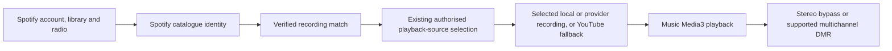
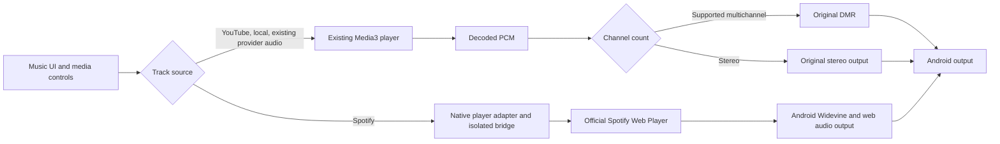

# Spotify integration: free accounts and direct playback

Reviewed 5 November 2026. The original target evaluated here is **Spotify Free as
well as Premium**, with direct Spotify playback inside Music. A YouTube match
must never be labelled Spotify playback. This report does not establish
successful live account playback, and no Spotify engine is currently integrated
into Music.

The follow-up [Telegram, Discord and broader repository review](SPOTIFY_COMMUNITY_RESEARCH.md)
recommends Spotify discovery/library plus Music's existing playback engine after
the catalogue-overlap discussion. The direct-playback architecture below remains
an investigated alternative, not a feature that has been implemented.

## Repository findings

| Project | Actual route | Fit for this request |
| --- | --- | --- |
| [Myspoti](https://github.com/kota-zo/myspoti) | Android native controls drive the official Spotify Web Player in a WebView. Android Widevine handles playback. Host request filtering and queue/ad recovery suppress ads. | Closest free-account Android candidate; needs a prototype and device validation. |
| [librespot](https://github.com/librespot-org/librespot) | Independent Spotify client/Connect receiver; the README explicitly requires Premium. | Does not meet the free-account requirement. |
| [librespot-java](https://github.com/librespot-org/librespot-java) / [Jetispot](https://github.com/iTaysonLab/jetispot) | Java/Android client route. librespot-java development moved to go-librespot; Jetispot is archived and documents Premium as required. | Do not base a new free-account engine on these older clients. |
| [Spotube](https://github.com/team-spotube/spotube) | Spotify metadata plugin supplies account/library/radio; a separate audio plugin resolves matching recordings. The built-in audio plugin is NewPipe YouTube. | Fits Spotify discovery with Music's existing playback engine; does not establish ad-free direct Spotify audio. |
| [SpotX](https://github.com/SpotX-Official/SpotX) | Patches the desktop Spotify client. | Not an embeddable Android playback engine. |
| [spotify-adblock](https://github.com/abba23/spotify-adblock) | Linux shared-library interception around Spotify's Chromium requests. | Not an Android playback engine. |

## Spotube: Spotify account and audio are separate

Inspected the current main application at
[`08f8f65a2a7fcfb94c69882333fe0a9f7e56d0ec`](https://github.com/team-spotube/spotube/tree/08f8f65a2a7fcfb94c69882333fe0a9f7e56d0ec)
and the external Spotify metadata plugin at
[`da3029066a1159d76ca3b81310ffe7918256bbc2`](https://github.com/sonic-liberation/spotube-plugin-spotify/tree/da3029066a1159d76ca3b81310ffe7918256bbc2).
These findings concern these implementations, not every possible third-party
Spotube audio plugin.

- [`BuiltInPlugins.kt`](https://github.com/team-spotube/spotube/blob/08f8f65a2a7fcfb94c69882333fe0a9f7e56d0ec/composeApp/src/commonMain/kotlin/org/spotube/spotube/modules/plugin/BuiltInPlugins.kt)
  registers NewPipe YouTube as an audio plugin and LRCLIB as a lyrics plugin.
  Spotify is not the built-in audio engine.
- The Spotify plugin's
  [`js.kt`](https://github.com/sonic-liberation/spotube-plugin-spotify/blob/da3029066a1159d76ca3b81310ffe7918256bbc2/spotube_plugin_spotify/src/jsMain/kotlin/io/github/sonic_liberation/spotube_plugin_spotify/js.kt)
  binds album, artist, browse, playlist, search, track and user metadata APIs.
  It does not bind the audio API. Its
  [`RealCoreAPI.kt`](https://github.com/sonic-liberation/spotube-plugin-spotify/blob/da3029066a1159d76ca3b81310ffe7918256bbc2/spotube_plugin_spotify/src/jsMain/kotlin/io/github/sonic_liberation/spotube_plugin_spotify/core/RealCoreAPI.kt)
  opens Spotify's login page, captures a Spotify web-session cookie, obtains
  session credentials and schedules refresh. This is a web-session integration,
  not an RTensorLabs developer OAuth registration or a Premium audio entitlement.
- [`RealMetadataTrackAPI.kt`](https://github.com/sonic-liberation/spotube-plugin-spotify/blob/da3029066a1159d76ca3b81310ffe7918256bbc2/spotube_plugin_spotify/src/commonMain/kotlin/io/github/sonic_liberation/spotube_plugin_spotify/core/RealMetadataTrackAPI.kt)
  implements song recommendations by requesting a radio playlist for the first
  seed and reading that playlist. The application's
  [`DeviceAudioPlayerQueue.kt`](https://github.com/team-spotube/spotube/blob/08f8f65a2a7fcfb94c69882333fe0a9f7e56d0ec/composeApp/src/commonMain/kotlin/org/spotube/spotube/core/audioplayer/DeviceAudioPlayerQueue.kt)
  asks the selected metadata plugin for recommendations during endless playback.
  This confirms a provider-radio route rather than replaying listening history
  as the next-song candidate pool.
- [`RealNewPipeAudioAPI.kt`](https://github.com/team-spotube/spotube/blob/08f8f65a2a7fcfb94c69882333fe0a9f7e56d0ec/composeApp/src/commonMain/kotlin/org/spotube/spotube/core/zipline/plugin_apis/newpipe_yt/RealNewPipeAudioAPI.kt)
  resolves YouTube items directly; otherwise it searches by ISRC, title and
  artist, scores matches, and returns YouTube audio streams. It can fall back to
  unconfident text-search guesses. That fallback can select the wrong version;
  Music should require a verified recording match or an explicit user selection.

The checked Spotify plugin also contains a diagnostic log that interpolates the
session cookie in its token-request function. Never copy that logging into Music;
account cookies and tokens must stay out of logs. No real credential values were
read or printed during this review.

The useful architecture for Music's earlier recommendation/DSP goal is:

This can preserve the current player and DSP, but the selected audio source must
be labelled honestly. Spotify recommendations do not turn a YouTube stream into
Spotify audio, lossless or Atmos. Conversely, a genuine authorised local/provider
multichannel match can still use Music's existing DMR path.

Spotube and the reviewed metadata plugin use AGPL-3.0-family licensing. No code
was copied, no plugin installed and no real Spotify login/playback tested. The
architecture is relevant; dropping their implementation into Music requires a
separate licence-compatible integration decision.

## Myspoti: checked beyond the README

Inspected source at commit
[`8e8898af03a21772357ae6248a41a33a28cd9b5e`](https://github.com/kota-zo/myspoti/tree/8e8898af03a21772357ae6248a41a33a28cd9b5e).

- [`WebPlayerHost.kt`](https://github.com/kota-zo/myspoti/blob/8e8898af03a21772357ae6248a41a33a28cd9b5e/base/host-android/src/main/kotlin/app/myspoti/host/android/WebPlayerHost.kt)
  creates the WebView, handles protected-media permission, intercepts requests,
  and reports licensing errors and renderer-process failure. Playback remains in
  the official web engine; it is not a raw Spotify audio decoder.
- [`player-bridge.js`](https://github.com/kota-zo/myspoti/blob/8e8898af03a21772357ae6248a41a33a28cd9b5e/base/api-spotify/src/main/resources/bridge/player-bridge.js)
  discovers the web player's services through its React context registry and
  relays player state and commands to native controls. This is an undocumented
  web-client interface, so a Spotify deployment can break it.
- [`BridgeHost.kt`](https://github.com/kota-zo/myspoti/blob/8e8898af03a21772357ae6248a41a33a28cd9b5e/base/api-spotify/src/main/kotlin/app/myspoti/spotify/bridge/BridgeHost.kt)
  contains ad-media request filtering **and playback-state-machine rewriting**.
  Describing the complete route as just a host blocklist would be inaccurate.
- [`AdRecoveryRules.kt`](https://github.com/kota-zo/myspoti/blob/8e8898af03a21772357ae6248a41a33a28cd9b5e/base/api-spotify/src/main/kotlin/app/myspoti/spotify/AdRecoveryRules.kt)
  and the bridge host document stuck-ad cases that require reload/recovery.
  Ad-free continuity must therefore be tested, not inferred from a blocked URL.
- [`AdBlockTest.kt`](https://github.com/kota-zo/myspoti/blob/8e8898af03a21772357ae6248a41a33a28cd9b5e/base/api-spotify/src/test/kotlin/app/myspoti/spotify/bridge/AdBlockTest.kt)
  distinguishes ad-media hosts from song, image, metadata and playback endpoints.
  These upstream tests were read, not executed in this review.

The project signs the listener into Spotify's own web page; this architecture
does not require Music to register a developer Client ID. That is different from
the official Android App Remote SDK, which controls the separately installed
Spotify app. It also does not turn Spotify Free into a Premium subscription or
establish access to lossless or Atmos audio.

Myspoti is GPL-3.0. No implementation was copied into Music. Reusing its code
would require satisfying that licence; an independent implementation of the
architecture must not be presented as a tested port of Myspoti.

## Integration boundary for Music

The candidate is a **second playback engine**, not another URL resolver for
`DefaultAudioSink`:

Spotify web audio does **not** expose decoded PCM to Music's sink. DMR, its
channel monitor and bit-perfect output claims must not be attached to this route.
Spotify account recommendations can later supply Spotify catalogue identities;
they must not be silently converted to YouTube identities in history or queues.

Music currently has only YouTube/local catalogue identities, and its player
service owns one ExoPlayer. A proper integration needs an explicit Spotify
identity, an engine adapter with the same controls/state contract, queue and
position reconciliation, and exclusive audio ownership when changing engines.
Launching a hidden browser without these changes would produce misleading
Play/Pause state, stale queue information and potentially two simultaneous songs.

Keep the existing providers and native audio path intact. Isolate Spotify's
WebView process and cookie storage so Google/Apple sign-out cannot erase its
session. Keep bridge access limited to the Spotify player origin, avoid tokens
in logs/IPC/UI state, and grant protected-media access only to trusted origins.

## Evidence required before claiming the integration works

1. A real **free** account signs in privately and plays direct Spotify songs;
   no Premium token, YouTube matching or test fixture supplies the audio.
2. Two or three full songs, with an actual ad opportunity between songs, play
   without an audible ad, infinite reload, lost selection or frozen position.
3. Native Play/Pause, seek, next/previous, queue selection and metadata stay in
   sync through loading, ads, reconnection and app background/foreground.
4. Notification/Bluetooth controls and audio focus work; switching from Spotify
   to the existing engine leaves exactly one engine audible.
5. Android 11 and a recent Android/WebView combination are tested. Unsupported
   Widevine, missing/outdated WebView, account rejection and renderer crashes
   produce actionable errors without modifying DRM or claiming success.
6. Existing stereo bypass, surround routing, provider accounts and OTA signing
   remain intact, and the optimized universal release remains below 100 MB.

No live Spotify account, Android phone or ad-break playback was tested during
this repository review. No new APK or OTA was published.
