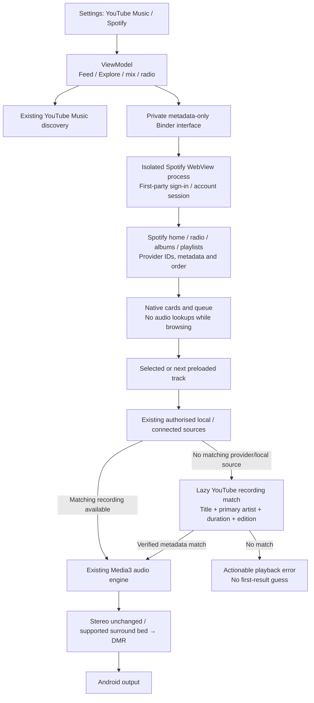

# YouTube Music / Spotify recommendation choice

Updated for Music 0.3.31 on Android 11+. Spotify is an experimental,
account-backed **metadata** connector. Its live sign-in, personalised feed/radio
and physical-phone performance have not been tested in this workspace.

## Using the option

1. Open **Settings → Playback → Recommendation source**.
2. YouTube Music is the default. Tap **Spotify** to open Spotify's own sign-in page
   inside Music. Email sign-in and linked-account pages are supported by the
   interactive browser. Complete Spotify’s sign-in, then use Continue/Connect if
   automatic confirmation has not finished. Reload and retry are available.
3. Music selects Spotify only after verifying the signed-in profile. The choice
   persists across app restarts. Reconnect if the session expires, or select
   YouTube Music at any time.
4. Home, Explore, Mixed for you and automatic Up next use the selected service.
   Spotify album/playlist cards open paged track lists. Selecting a song plays it
   through Music's existing engine. Search remains YouTube search in this version.

A Spotify developer registration is not required by this browser-session route.
It uses the listener's session in Spotify's own page rather than a borrowed
native-app OAuth client ID. This is an undocumented interface and can break when
Spotify changes its web application. Free/Premium account compatibility has not
been confirmed with real accounts; no Premium entitlement is manufactured.

The current song, position, Play/Pause state and manually queued songs survive a
source change. Only future automatically generated tracks are removed and
refilled from the new service. Explicit album/playlist/Play all queues retain
their order, and autoplay extends their end. History supplies optional seed songs,
never replacement candidates when a provider request fails. Local-only files do
not seed radio. An expired Spotify session produces a reconnect message instead
of silently substituting history or another recommendation service.

## Data and audio flow

Spotify does not supply the audio here. Discovery choice cannot make a YouTube
stream lossless or Atmos, and Spotify catalogue badges are not audio-format
proof. Existing decoder/DMR diagnostics describe the selected actual stream.
No direct Spotify player, ad-skipping playback engine or second audible browser
player is introduced.

Spotify identity is stored separately on a track and remains stable when a
YouTube fallback match is resolved. Saved/history identity does not change when
an initially unresolved Spotify card becomes a playable matched recording.
Matching requires known durations within 2% (bounded to 2.5–6 seconds), matching
primary artist and title, and compatible editions; live/remix/cover/remaster and
other edition differences are rejected. This is conservative metadata matching,
not an audio fingerprint or an ISRC guarantee. A user-selectable replacement
version would be a useful later addition for unmatched tracks.

## Isolation and performance

- Spotify runs in `:spotify_metadata` with its own WebView data-directory suffix.
  Signing out clears that profile without clearing YouTube/Apple browser data.
- Password fields stay on Spotify's page. Native IPC exposes only the allowlisted
  catalogue commands and normalised DTOs, not cookies, bearer tokens or player
  controls. The service/activity are not exported, Binder checks the calling UID,
  and the page bridge is restricted to the HTTPS Spotify top frame.
- The token is used inside Spotify's page. A verified session cookie checkpoint
  is encrypted with Android KeyStore. WebView also maintains its ordinary private
  sandbox cookie/storage directory; this document does not claim every WebView
  cache file is separately encrypted by Music.
- File/content access, mixed content, third-party cookies and all WebChrome
  permission requests are disabled. Audio/video playback is paused by the bridge;
  no protected-media permission is granted. Only interactive sign-in can visit the allowlisted Google, Apple or Facebook
  authentication pages. The catalogue bridge remains restricted to Spotify,
  and hidden background requests cannot navigate to another login provider.
- Home/catalogue results are cached ten minutes and concurrent identical requests
  coalesce. Switching accounts invalidates pending results and caches. Cache size
  is bounded, sign-in cancellation cannot revive a stale account, and source
  changes cancel obsolete feed/radio work.
- Matches are cached seven days (at most 256 entries), with single-flight lookups
  and at most three concurrent searches. These are canonical catalogue URLs,
  never expiring audio URLs or account credentials.
- Browser metadata and matches run outside audio rendering. Large playlists
  remain paged; only a selected/next preloaded track needs fallback matching.
  Hidden-browser artwork loads are disabled.
- Persisted query definitions are discovered from Spotify's current published
  application assets. There is no frozen query-hash list or app client secret.
  Asset scanning, traversal, result size and request time are bounded. Unsupported
  page changes fail safely with a reconnect/YouTube option.

## Verification boundaries

`node --test spotify-engine/test/catalogue.test.mjs` runs ten tests against a
simulated Spotify page: profile privacy, anonymous-session rejection, Home/radio
requests, lazy current-operation discovery, strict collection paging, track-detail artist fields, command
allowlisting, transient asset retry, sanitised errors and origin/subframe/message guards.

Android/JVM tests cover preference persistence, stable track identity, strict
recording matches, cache expiry/coalescing, stale feed/sign-in invalidation,
expired sessions, HTTPS navigation, lazy MediaSource resolution, local-source
priority, match-failure wording, canonical session-item validation, queue
preservation/cancellation and the actual Compose settings controls. Existing app,
audio and packaging checks are run separately; see [verification](VERIFICATION.md).

The current public Spotify desktop application and lazy search asset were also
inspected to confirm that `home`, `fetchPlaylistContents`, `getAlbum`, `getTrack`
and `searchTracks` operation definitions are present. This confirms discovery of
those definitions. A browser test also reads Spotify’s public anonymous Home,
search, track details, song radio, album and two playlist pages; all seven checks
pass with complete recording metadata. The test harness permits only the page’s
own anonymous catalogue access; the app’s sign-in requirement is unchanged.
These checks do not prove authenticated response compatibility,
personalised radio availability, login completion, actual audio playback or phone smoothness.
No signed-in account credentials were supplied or used for these public checks.

Before treating Spotify as stable, test an actual account on Android 11 and a
recent WebView: sign-in/restart/reconnect, Home and album/playlist paging, radio,
several full tracks, source switching during playback and with a manual queue,
seek/next/background controls, account expiry and memory/scrolling performance.
No existing provider or DSP feature was removed to add this option.

The 0.3.31 sign-in fix transports reply callbacks using the framework Binder
receiver, so verification does not depend on loading an app-private anonymous
class in the metadata process. Android 11 and Android 15 host tests cover the
real client/service reply path. Browser ownership survives background requests;
page changes and timeouts settle with retry feedback. These tests do not replace
a live subscriber/free-account sign-in on an Android phone.
